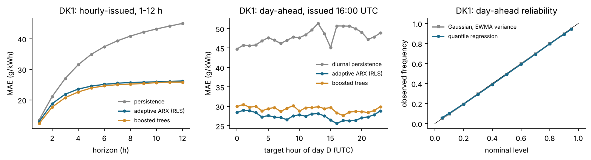
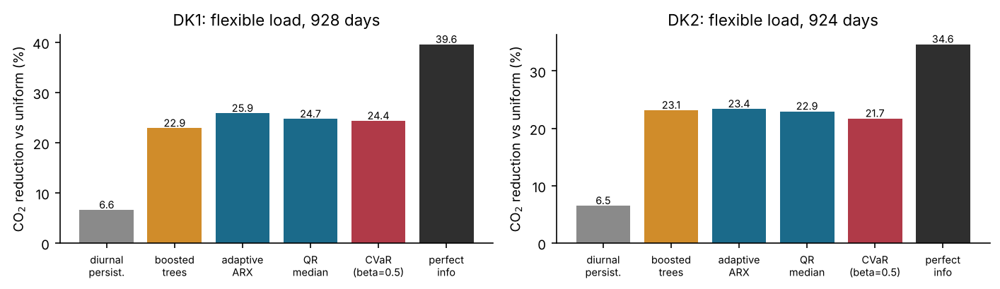

# Probabilistic Forecasting of Danish Grid Carbon Intensity for Flexible Data-Centre Load

Independent technical study, October 2026 (Xiangyu Luo).
Report: [`report/main.pdf`](report/main.pdf) (7 pages).

The hourly CO₂ intensity of consumed electricity in both Danish bidding zones
(DK1, DK2) is forecast from Energinet open data, and the forecasts are used to
schedule deferrable data-centre load. Three questions are studied:

1. **Forecasting.** How accurate are adaptive linear models, issued every hour
   for 1–12 h and once a day for the next day (9–32 h), in a chronological
   backtest that uses each input only after its assumed publication time?
2. **Uncertainty.** Are Gaussian, quantile-regression and conformal predictive
   intervals calibrated, also in the high-intensity hours a scheduler cares about?
3. **Decisions.** How much of the attainable emission reduction does a flexible
   load realise on these forecasts, and can a compact aggregate model of a
   heterogeneous fleet be split back into feasible site schedules?

## Main results (test period 2024-01-01 to 2026-09-30)

| | DK1 | DK2 |
|---|---|---|
| Day-ahead MAE, diurnal persistence (g CO₂/kWh) | 47.9 | 27.3 |
| Day-ahead MAE, adaptive ARX by recursive least squares | **27.5** (−43%) | **18.2** (−33%) |
| Day-ahead MAE, gradient-boosted trees (monthly refit) | 29.3 | 17.6 |
| Pooled coverage of the nominal 90% interval: Gaussian / quantile regression / QR + adaptive conformal | 89.4 / 88.5 / **90.0** % | 90.7 / 83.7 / **90.5** % |
| same, hours in the top quintile of the forecast | 85.2 / 91.4 / 92.3 % | 85.5 / 89.4 / 91.0 % |
| Simulated scheduling: share of the perfect-information reduction in accounted CO₂ (persistence → adaptive ARX) | 17% → **65%** | 19% → **67%** |
| Fleet of 30 sites: energy of a single-envelope plan that sites cannot deliver | 7.6% | 7.8% |

* The adaptive ARX model is significantly better than diurnal persistence in
  both zones and than the trees in DK1 (Diebold–Mariano, p < 10⁻⁴); in DK2 the
  difference to the trees is not significant (p = 0.09). For the hourly-issued
  product the trees are more accurate at every horizon.
* A Gaussian distribution with recursive variance is calibrated on average but
  covers only about 85% in high-intensity hours; quantile regression with an
  adaptive conformal correction gives pooled coverage of 90.0–90.5% and about 91–92%
  in those hours.
* Scheduling 6 MWh of deferrable daily load on the adaptive forecast cuts the
  emissions of that energy by 25.9% (DK1) and 23.4% (DK2) relative to uniform
  operation. Mean–CVaR schedules on Gaussian-copula scenarios lower the 95th
  percentile of the daily regret only slightly (DK1: 228 → 227 kg) at a cost of
  1.5–1.7 percentage points of mean reduction.
* A single virtual-battery envelope (summed power and cumulative-energy bounds)
  over-states the fleet's flexibility: on every test day part of the aggregate
  plan cannot be executed by the sites; grouping sites with similar windows
  helps only gradually (6.6% undeliverable with 10 groups in DK1).

Emission figures use Energinet's average intensity of consumed electricity
(location-based accounting); they are not marginal emission reductions of the
power system.




## Data and information set

All data are public, from [Energi Data Service](https://www.energidataservice.dk/)
(Energinet), 2023-01-01 to 2026-09-30, hourly, UTC.

| Dataset | Use | Assumed known |
|---|---|---|
| `CO2Emis` (5-min) | target and lags | end of each hour |
| `Forecasts_Hour` (`ForecastDayAhead`) | wind (on- + offshore) and solar forecast | for day D before 12:00 UTC on D−1 |
| `Elspotprices` / `DayAheadPrices` | price of the zone and of DE, NO2, SE3, SE4 | for day D after the auction on D−1 |
| `CO2EmisProg` | reference only | archive keeps the last intraday update, so it is not a day-ahead forecast |

Hours with fewer than 9 of 12 five-minute values are missing; negative values
and isolated spikes not shared by Energinet's schedule-based estimate are removed
(2 hours in DK1, 4 in DK2). Burn-in 2023H1, forgetting factors chosen on 2023H2,
scores on 2024-01 to 2026-09. Every adaptive model absorbs a pair only after its
target has been observed (unit-tested).

## Repository

| Path | Content |
|---|---|
| `src/data.py` | download from the API and build `data/processed/hourly_DK{1,2}.csv.gz` |
| `src/features.py` | cleaning and information-set-consistent design matrices |
| `src/models.py` | RLS with forgetting, weighted quantile regression (LP), adaptive conformal inference, Gaussian-copula scenarios |
| `src/run_forecast.py` | rolling-origin experiment (short-term and day-ahead products) |
| `src/evaluate.py` | scores, Diebold–Mariano tests, figures |
| `src/scheduling.py`, `src/run_schedule.py` | flexible-load LPs, mean–CVaR LP, fleet envelope, disaggregation LP |
| `src/make_numbers.py` | writes every number quoted in the report (`report/numbers.tex`) |
| `results/` | summaries (JSON/CSV), day-ahead forecasts, figures |
| `report/` | LaTeX source and PDF |
| `tests/` | unit tests |

## Running

```bash
pip install -r requirements.txt          # tested with numpy 2.5, pandas 3.0, scipy 1.18, scikit-learn 1.9
python src/data.py                       # downloads about 8 MB of raw data (or use --skip-download with data/raw present)
python src/run_forecast.py               # ~1.5 h on 2 cores (quantile regressions); --quick skips the trees
python src/evaluate.py
python src/run_schedule.py               # ~3 min
python src/make_numbers.py
cd report && pdflatex main.tex && pdflatex main.tex
python -m unittest discover -s tests     # < 1 s
```

The processed hourly tables are included, so everything after `data.py` runs
offline. The hourly-issued forecast tables (`results/forecasts/st_*.csv.gz`,
about 20 MB each) are not committed; they are regenerated by `run_forecast.py`.

## Limitations

* Average, not marginal, emission intensity; release times of the day-ahead
  inputs are assumed from market practice, and archived values may include later
  revisions of the same forecast.
* Hourly resolution only; five-minute horizons, weather inputs and hierarchical
  reconciliation are not included.
* The flexible load is a deferrable energy block without thermal (cooling)
  dynamics; the fleet is synthetic (30 sites, seed 7).

Data: Energi Data Service, Energinet (CC BY 4.0).
